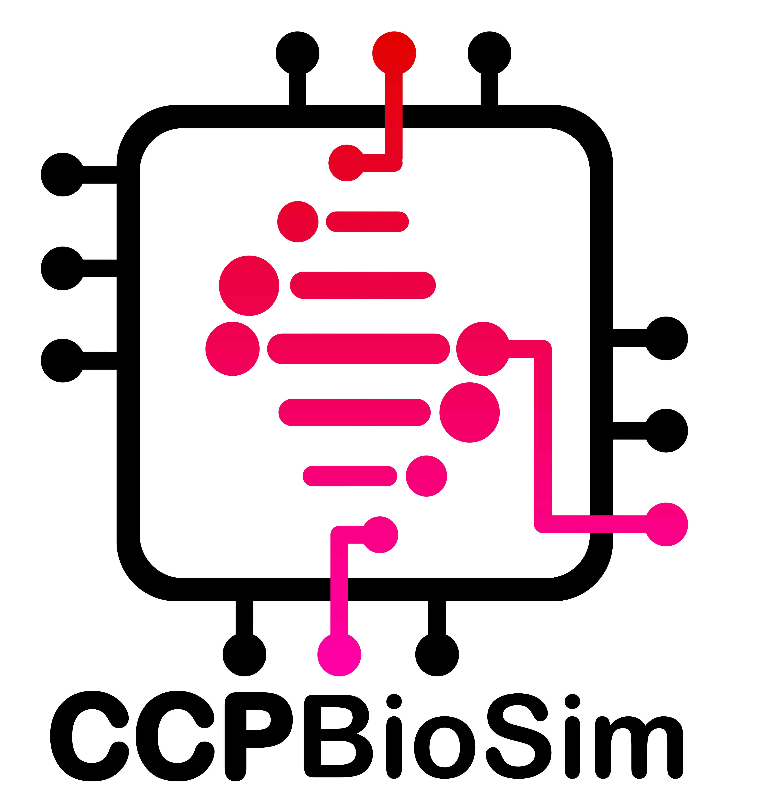

:html_theme.sidebar_secondary.remove:

biosimdb-interface
==================

.. ccpbiosim-hero::
   :logo-light: _static/logos/biosimdb-logo-black.png
   :logo-dark: _static/logos/biosimdb-logo-white.png
   :logo-alt: BioSimDB logo
   :tagline: biosimdb-interface
   :button: biosimdb_intro | Get started
   :github: CCPBioSim/biosimdb-interface

   A web interface for extracting simulation metadata and uploading it to BioSimDB

A web interface for extracting simulation metadata and uploading it to the
`BioSimDB <https://data-collections.psdi.ac.uk/communities/biosimdb>`_ community data collection,
hosted by PSDI.

Explore the documentation
-------------------------

.. grid:: 1 2 2 2
   :gutter: 3

   .. grid-item-card:: 🗄️ Access to BioSimDB
      :link: biosimdb_intro
      :link-type: doc

      Use the hosted webform to submit simulations to BioSimDB.

   .. grid-item-card:: 🖥️ Run your own Interface Instance
      :link: interface_instance_intro
      :link-type: doc

      Install, configure and run your own instance.

   .. grid-item-card:: 👩‍💻 Contributing
      :link: contributing
      :link-type: doc

      Setting up a development environment and contributing.

   .. grid-item-card:: 📖 API
      :link: reference/biosimdb_interface/index
      :link-type: doc

      Reference for the biosimdb-interface package.

.. toctree::
   :maxdepth: 2
   :hidden:

   Access to BioSimDB <biosimdb_intro>
   Run your own Instance <interface_instance_intro>
   Contributing <contributing>
   API <reference/biosimdb_interface/index>

Funding
-------

Contributors to biosimdb-interface were supported by

